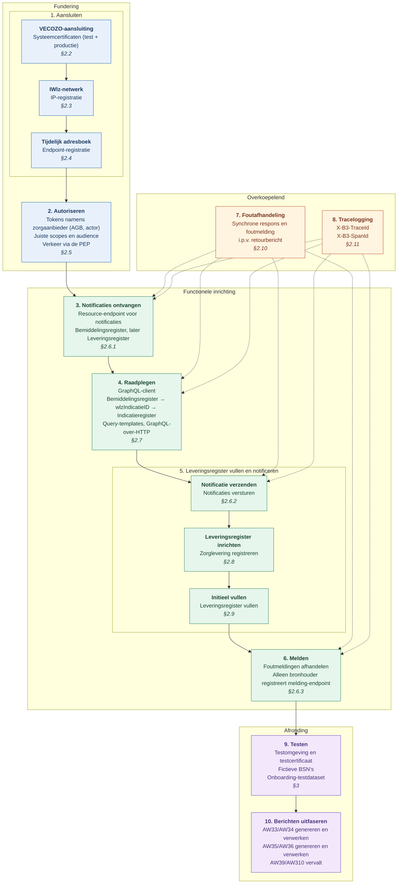

# Samenvatting implementatiestappen

!!! note  
    Let op: tijdens de overgangsfase: wanneer niet alle aanbieders zijn aangesloten op het netwerkmodel, blijft [Silvester](https://istandaarden.github.io/Afsprakenstelsel-iWlz/current/applicatie/silvester/) voor niet-aangesloten partijen AW33-berichten genereren.   
    Zie: Wat verandert er > [§1.1](./1-wat-verandert-er.md#11-van-estafette-naar-netwerk), en : Implementatiestappen > [§2.1](./2-implementatiestappen.md#21-controleer-of-je-systeem-netwerkmodel-proof-is).